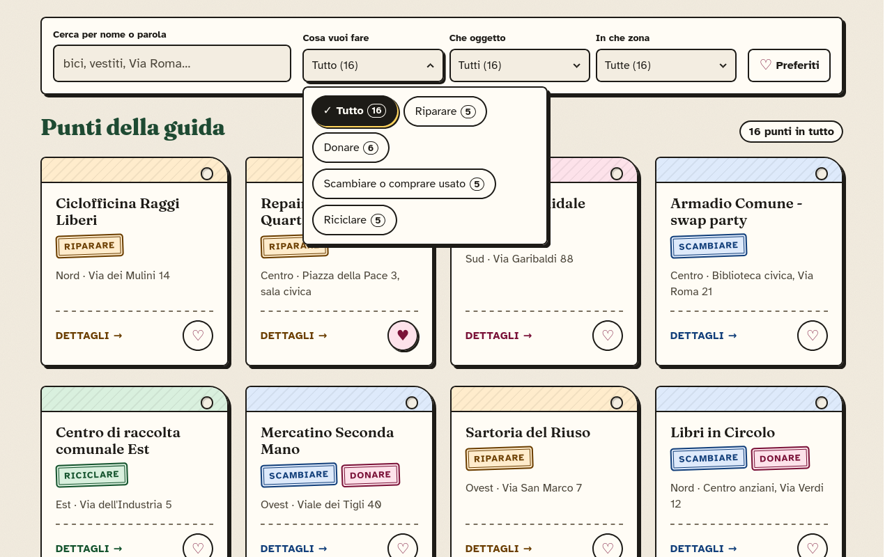
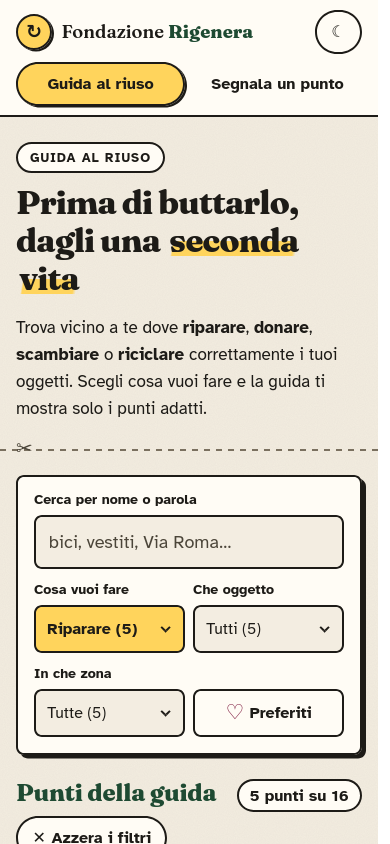

# Guida al riuso – Fondazione Rigenera

### 👉 [Apri il sito online](https://michelecampanello.github.io/rigenera/)

Una guida per i cittadini che vogliono dare una seconda vita agli oggetti invece di buttarli: dove **ripararli**, **donarli**, **scambiarli** o **riciclarli** correttamente. Si sceglie cosa si vuole fare, che oggetto si ha e in che zona, e la guida mostra solo i punti adatti. I cittadini possono anche segnalare nuovi punti.

Sito statico in **HTML, CSS e JavaScript "vanilla"**: nessun framework, nessun back end, nessun database.



Sul telefono la barra dei filtri occupa poche righe: ricerca a tutta larghezza, poi i tre menu a tendina e il filtro dei preferiti in fondo a destra.



```
docs/index.html            → la guida: ricerca, filtri ed elenco dei punti
docs/segnala.html          → modulo con cui i cittadini segnalano nuovi punti
docs/css/01-…16-*.css      → lo stile, diviso per sezione (variabili, base, testata, filtri, elenco, modulo, ricerca e preferiti, tema scuro, validazione, finestra dei dettagli)
docs/js/data.js            → SOLO DATI: i punti della guida e i nomi di azioni, categorie e zone
docs/js/comune.js          → parti comuni alle due pagine: gruppi di filtri, segnalazioni salvate, sicurezza del testo
docs/js/schede.js          → trasforma i punti in schede dell'elenco
docs/js/dettaglio.js       → finestra con tutti i dettagli di un punto
docs/js/filtri.js          → pillole dei filtri, ricerca, conteggi e annuncio dei risultati
docs/js/tendine.js         → apre e chiude i menu a tendina dei filtri (clic, tastiera, Esc)
docs/js/modulo.js          → modulo di segnalazione: caselle, salvataggio, messaggio finale
docs/js/avvio.js           → si carica per ultimo e avvia ciò che serve alla pagina
docs/js/preferiti.js       → salva e rilegge i punti preferiti (localStorage)
docs/js/tema.js            → tema chiaro/scuro, con la scelta salvata nel browser
docs/js/validazione.js     → controlli del modulo di segnalazione, con l'errore sotto ogni campo
docs/img/                  → favicon, anteprima per i social, screenshot (computer e telefono)
```

---

## Il team: chi ha fatto cosa

| Persona | Contributo |
|---|---|
| **Michele Campanello** ([@michelecampanello](https://github.com/michelecampanello)) | Struttura HTML delle pagine, design system CSS (variabili e file numerati), schede e filtri dinamici con i conteggi, modulo di segnalazione e salvataggio, pubblicazione su GitHub Pages |
| **Cristian** ([@cristiancipriani97-ux](https://github.com/cristiancipriani97-ux)) | Validazione in JavaScript del modulo di segnalazione, con i messaggi di errore vicino ai campi |
| **Raffaele Feola** ([@Rafeola](https://github.com/Rafeola)) | Ricerca testuale, messaggio "nessun risultato", preferiti, tema scuro, dati spostati in `data.js`, tag OpenGraph, README |

Ognuno ha lavorato su un proprio branch; le modifiche sono entrate in `main` tramite pull request con revisione di un compagno.

---

## Come avviarlo in locale

1. Clona il repository: `git clone https://github.com/michelecampanello/rigenera.git` (oppure *File → Clone repository* in GitHub Desktop).
2. Apri `docs/index.html` con un doppio clic: il sito funziona senza installare nulla.
3. In alternativa, in VS Code apri la cartella e avvia l'estensione **Live Server** su `docs/index.html`, così la pagina si ricarica a ogni modifica.

**GitHub Pages:** in *Settings → Pages → Build and deployment* scegliere *Deploy from a branch*, branch `main`, cartella `/docs`. Il sito è anche caricabile su qualsiasi hosting statico (Netlify, l'hosting già in uso dalla Fondazione).

---

## Dalle richieste di Giulia alle scelte tecniche

### 1. "Per tutti i cittadini, leggibile dal telefono, accessibile"

| Scelta | Perché |
|---|---|
| **Mobile first**, un'unica colonna sul telefono, filtri laterali fissi solo da 62rem in su | La maggior parte delle persone arriverà dal telefono, magari per strada. |
| **Testo base a 18px**, misure in `rem`, titoli con `clamp()` | Più leggibile dello standard di 16px; i `rem` rispettano lo zoom e la dimensione del testo impostata dall'utente. |
| **Contrasti ≥ 7:1** per il testo (livello AAA) e ≥ 3:1 per i bordi dei controlli | Pensato per chi ha difficoltà visive o usa il telefono sotto il sole. |
| **Aree di tocco di almeno 44px** su menu e pillole dei filtri, link, bottoni e caselle | Utili per chi ha poca precisione nelle mani o usa il telefono con una mano sola. |
| **HTML semantico**: `header`, `nav`, `main`, `footer`, `article`, `fieldset`/`legend`, liste vere, `dl` per zona/indirizzo/orari | I lettori di schermo annunciano correttamente struttura, gruppi di filtri e numero di schede. |
| **Navigazione da tastiera**: link "Vai direttamente ai punti", focus arancione sempre visibile, filtri fatti di veri `radio` dentro menu a tendina (frecce per scegliere, Esc per chiudere) | Chi usa la tastiera non deve mai "perdersi". |
| **Il colore non è mai l'unica informazione**: la scelta attiva ha anche il segno ✓, le etichette delle azioni hanno testo esplicito | Utile per chi non distingue i colori. |
| `prefers-reduced-motion`, `forced-colors` (contrasto elevato di Windows), stile di **stampa** | Rispetta le preferenze di sistema; molte persone anziane preferiscono stampare l'elenco. |
| Linguaggio semplice: "Cosa vuoi fare", "Che oggetto hai", "In che zona" | Sono le domande che la persona si fa già, nell'ordine in cui se le fa. |

### 2. "Trovare il punto giusto in pochi secondi"

Tre gruppi di filtri che corrispondono al bisogno reale: **azione → oggetto → zona**. "Dove riparo la bici?" si risolve con due tocchi.

**Filtri dinamici.** I filtri sono tre menu a tendina in una barra compatta sopra l'elenco, con "♡ Preferiti" a destra. Ogni menu è un bottone (con `aria-expanded`) che apre una tendina con le pillole del gruppo, nello stesso stile del resto del sito. Le pillole non sono scritte a mano: `filtri.js` le genera da `GRUPPI_FILTRI`, che a sua volta usa `NOMI_AZIONI`, `NOMI_CATEGORIE` e `NOMI_ZONE`. Ogni pillola è un vero pulsante `radio`: con la tastiera si entra nella tendina con Tab, si sceglie con le frecce e si chiude con Esc; con il mouse o il dito un tocco sceglie e chiude. Un menu con un filtro scelto è evidenziato in giallo. Su computer la barra sta su una riga sola e resta in vista mentre si scorre.

Perché non un `<select>`: l'elenco aperto di un `<select>` lo disegna il sistema operativo e quasi non si può personalizzare (il nuovo `appearance: base-select` per ora funziona solo in Chrome).

- I tre gruppi si combinano: resta visibile solo ciò che supera tutti i filtri. Le schede escluse ricevono l'attributo `hidden`, quindi spariscono anche per il lettore di schermo.
- Un punto può avere **più azioni o categorie**.
- **Ogni pillola mostra quanti punti troverebbe**, tenendo fermi gli altri filtri; il bottone del menu mostra la scelta con il suo numero, per esempio "Riparare (5)". Le pillole che non troverebbero nulla hanno il bordo tratteggiato ma restano selezionabili.
- **"Azzera i filtri"** è un `<button type="reset">` nativo accanto al numero di punti trovati: riporta tutto su "Tutto" e compare solo quando c'è qualcosa da azzerare.
- Il **numero di risultati** sotto l'elenco è calcolato da un contatore CSS (`counter()`): le schede nascoste non vengono contate.
- **Annuncio per i lettori di schermo**: a ogni cambio di filtro (e dopo "Azzera i filtri") il numero di punti trovati viene scritto in una regione `aria-live`, invisibile a schermo, che il lettore di schermo legge da solo.
- Se JavaScript è disattivato, al posto dell'elenco compare un avviso (`<noscript>`).

### 3. "Aggiornare l'elenco non deve diventare un incubo"

I punti sono dati, non HTML: stanno nell'array `PUNTI_GUIDA` del file **`data.js`**, separato dalla logica. In cima al file è descritta la forma di ogni punto e i valori ammessi. La funzione `creaScheda()` di `schede.js` trasforma ogni punto in una scheda con gli attributi `data-azione`, `data-categoria` e `data-zona` (usati dal CSS per il colore del cartellino).

1. **Per aggiungere un punto basta aggiungere un oggetto all'array** in `data.js`, con un `id` nuovo.
2. **Non si tocca né l'HTML né il CSS né il JavaScript**: filtri e conteggi si aggiornano da soli.
3. Ogni punto ha un **`id` unico e stabile** (es. `"raggi-liberi"`), mai la posizione nell'array: i preferiti sono salvati per `id`, quindi restano giusti anche se l'elenco viene riordinato.

Per aggiungere una **nuova categoria o zona** basta una voce in `NOMI_CATEGORIE` o `NOMI_ZONE` di `data.js`: compaiono da sole sia la pillola nei filtri sia la casella (o l'opzione della zona) nel modulo di `segnala.html`.

Nel `localStorage` restano solo le **segnalazioni dei cittadini**, non tutto l'elenco: così un punto aggiunto in `data.js` compare subito anche a chi aveva già visitato il sito.

### 4. "I cittadini possono segnalarci nuovi punti"

`segnala.html` contiene un modulo con gli stessi campi di una scheda (nome, azioni, categorie, zona, indirizzo, orari, descrizione), più un contatto facoltativo e il consenso privacy. Le caselle di azioni e categorie e le opzioni della zona vengono generate da `modulo.js` con gli stessi dati dei filtri, quindi guida e modulo non possono andare fuori sincrono.

- Il punto segnalato viene **salvato nel `localStorage`** (solo le segnalazioni, con la stessa forma dei punti di `data.js`) e compare subito nell'elenco, con il link al sito se è stato indicato (solo indirizzi `http`/`https`).
- **Validazione in JavaScript** (`validazione.js`): campi obbligatori, almeno un'azione scelta, formato dell'e-mail e del sito. Ogni errore compare **sotto il proprio campo**, il campo riceve `aria-invalid` e `aria-describedby` (così il lettore di schermo legge l'errore) e il cursore va sul primo campo sbagliato. L'errore sparisce appena il campo viene corretto.
- `autocomplete` e `inputmode` sui campi, per compilare più in fretta dal telefono.
- Un **campo-trappola anti-spam** (honeypot), invisibile alle persone.
- **Da fare:** oggi le segnalazioni vengono pubblicate subito, senza la verifica della Fondazione promessa nel testo del modulo. Serve uno stato "da verificare" (vedi fase 2).

### 5. Ricerca, preferiti e tema scuro

- **Ricerca testuale** nella barra dei filtri: cerca nel nome, nella descrizione e nell'indirizzo, senza distinguere maiuscole e accenti ("cafe" trova "Café"). Con più parole il punto deve contenerle tutte. Si combina con i tre menu e i conteggi delle pillole ne tengono conto.
- **Messaggio "nessun risultato" visibile** sopra l'elenco quando ricerca e filtri non trovano nulla, oltre all'annuncio per i lettori di schermo.
- **Schede essenziali e finestra dei dettagli**: nell'elenco ogni scheda mostra solo nome, azioni e "zona · indirizzo", così si scorre in fretta. Toccando la scheda si apre una finestra (`<dialog>` con `showModal()`) con descrizione, oggetti accettati, orari e sito. Il browser tiene il focus dentro la finestra e la chiude con Esc; si chiude anche con "Chiudi" o toccando fuori, e il focus torna alla scheda. Sul telefono la finestra sale dal basso. In stampa i dettagli completi compaiono dentro ogni scheda.
- **Preferiti**: ogni scheda ha il cuore "♡" e la finestra dei dettagli il bottone "♡ Preferito" (veri `<button>` con `aria-pressed`, sempre allineati tra loro). Nel `localStorage` si salva solo l'elenco degli `id` dei punti, non le schede. Al primo avvio, quando non c'è ancora nulla di salvato, si parte da un elenco vuoto. Il filtro "♡ Preferiti", a destra nella barra, mostra solo i punti salvati.
- **Tema scuro**: bottone "Tema scuro" nella testata di entrambe le pagine. Se l'utente non ha mai scelto, il sito segue l'impostazione del sistema (`prefers-color-scheme`). Il tema ridefinisce le variabili di `01-variabili.css`, quindi gli altri file CSS non cambiano. Contrasti del testo ≥ 7:1 anche nel tema scuro; la stampa resta sempre chiara.

### 6. SEO di base

Ogni pagina ha `title`, `meta description` e i tag **OpenGraph** essenziali (`og:title`, `og:description`, `og:url`, `og:image`): quando il link viene condiviso su WhatsApp o sui social compare un'anteprima con titolo, descrizione e immagine (`docs/img/anteprima-social.png`).

---

## Uso dell'intelligenza artificiale

Durante il progetto abbiamo usato assistenti AI (Claude) per farci spiegare concetti, rivedere il codice e scrivere alcune parti. Ogni modifica è passata da una pull request ed è stata riletta: abbiamo tenuto solo codice che sappiamo spiegare. La riflessione completa è nella presentazione.

---

## Limiti noti

- **Dati solo nel browser**: il `localStorage` vive in un solo browser di un solo dispositivo. Un punto segnalato da un cittadino non arriva né alla Fondazione né agli altri visitatori.
- **Molti punti**: sopra il centinaio di schede, mantenerle a mano in un array dentro `data.js` diventa scomodo.
- **Indirizzo del sito nei tag OpenGraph**: `og:url` e `og:image` contengono l'indirizzo completo del sito. Se il repository cambia nome vanno aggiornati in `index.html` e `segnala.html`.

## Proposta per la fase 2 (quando i punti cresceranno)

Il markup e il CSS di questa versione restano validi: cambia solo **dove vivono i dati**.

1. **Dati in un file gestito senza codice** (`punti.json` o un foglio Google), da cui un generatore di siti statici (es. **Eleventy**) crea l'HTML in automatico a ogni modifica. Il CSS dei filtri resta identico.
2. **Pannello di modifica senza codice** con un CMS headless gratuito (es. **Decap CMS**): Giulia aggiunge e modifica i punti da un modulo web, senza mai aprire un file HTML.
3. **Più JavaScript progressivo**, per esempio una mappa dei punti.
4. Le segnalazioni del modulo possono arrivare direttamente come bozze nel CMS, invece che per e-mail.

> Nota: i punti presenti nella guida sono **dati di esempio** inventati, da sostituire con quelli reali della Fondazione.
